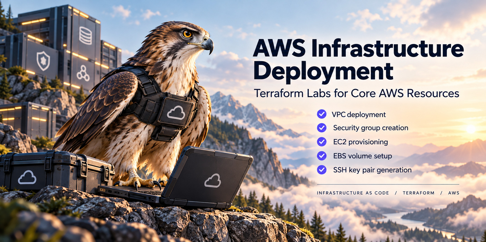
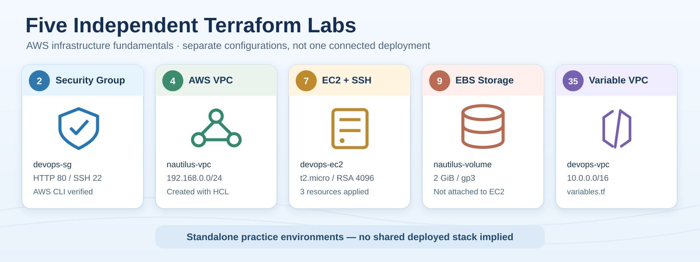
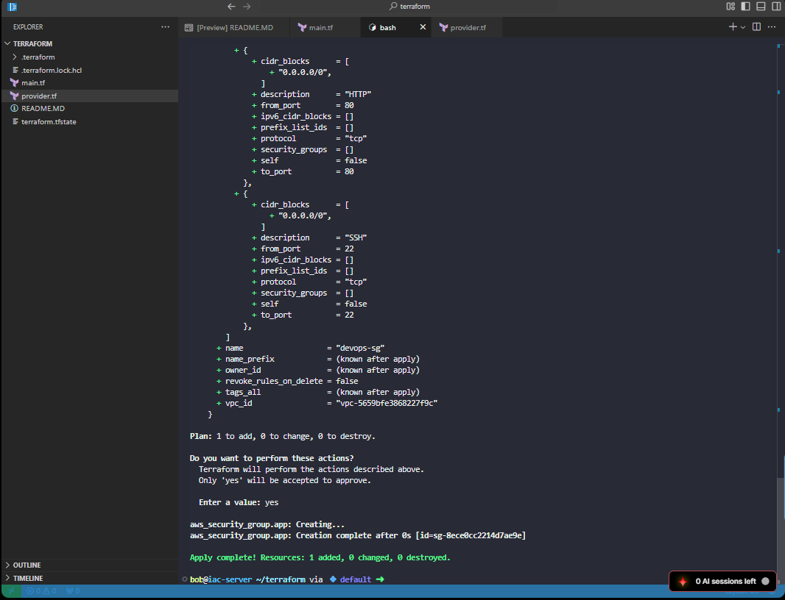
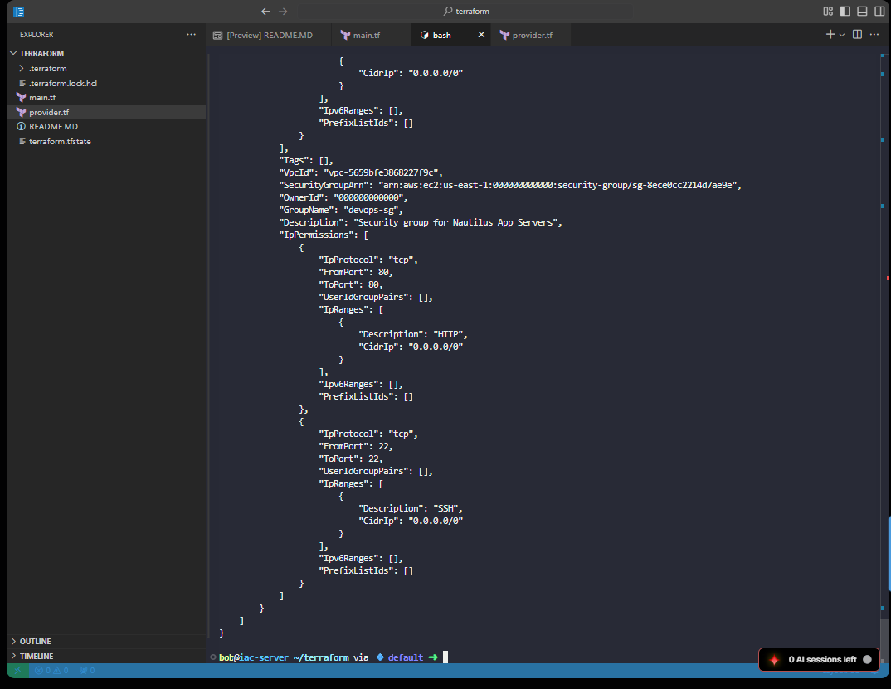
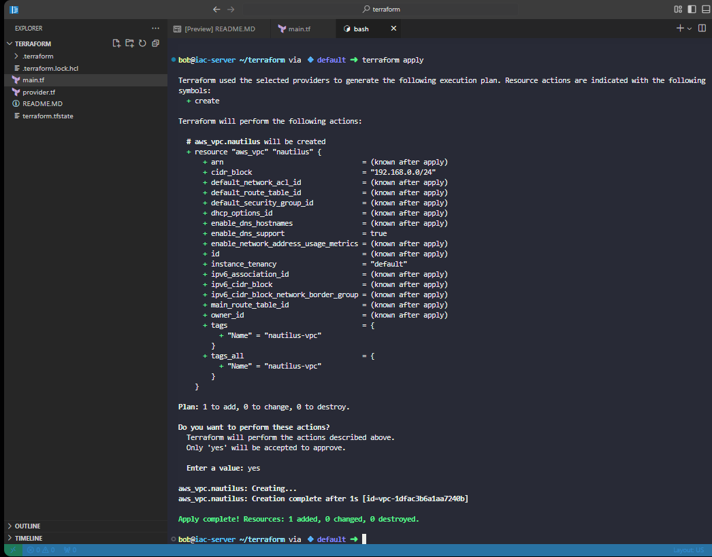
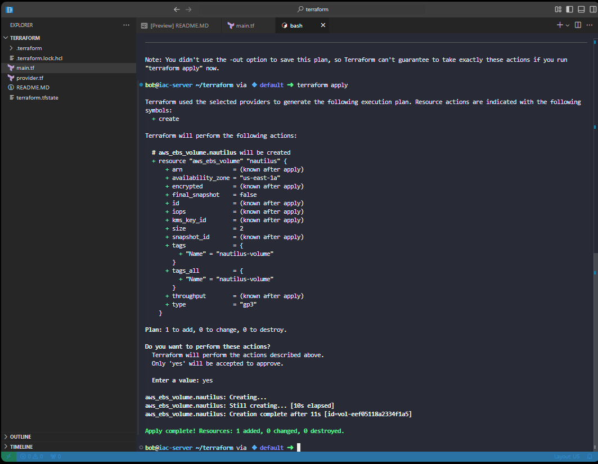
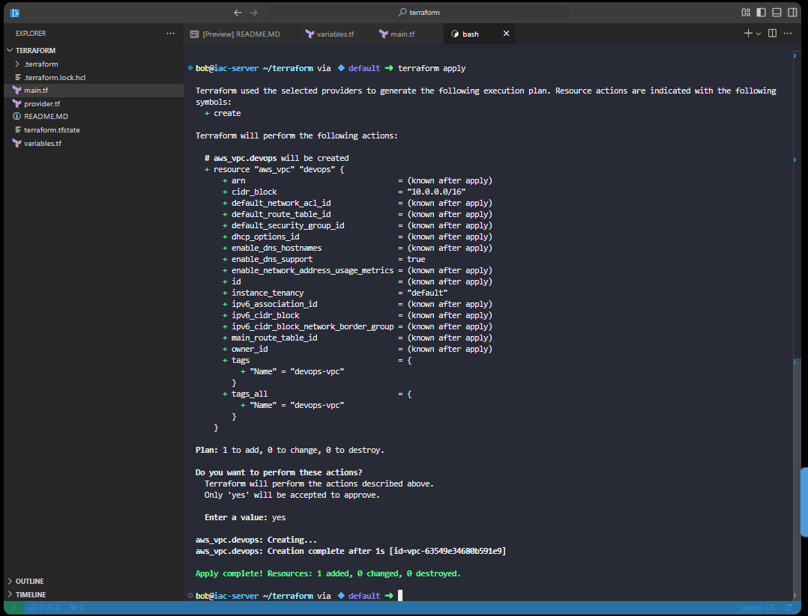

# AWS Infrastructure Deployment with Terraform

**Five independent infrastructure-as-code labs: networking, compute, storage, and reusable configuration**  
KodeKloud — Nautilus DevOps hands-on labs



## Project Overview

I completed **five Terraform labs** covering core AWS infrastructure tasks: creating a security group, provisioning a VPC, launching an EC2 instance with an SSH key pair, creating an EBS volume, and deploying a VPC using input variables.

The Nautilus DevOps scenarios centered on a gradual move toward cloud infrastructure. The common requirement was to define resources in code, review proposed changes, and confirm what Terraform actually created rather than repeating manual configuration in the AWS console.

**These were separate exercises in a training environment, not one integrated AWS architecture.** In particular, the EC2 instance was not demonstrated running inside either newly created VPC, and the EBS volume was not attached to that instance.

**Technologies:** Terraform · AWS provider · Amazon VPC · EC2 · EBS · Security Groups · TLS provider · HCL · AWS CLI

## Lab Overview



| Lab | Focus | Verified or documented outcome |
|---|---|---|
| **2** | AWS security group | `devops-sg` created; inbound and outbound rules checked using the AWS CLI against the lab endpoint |
| **4** | AWS VPC | `nautilus-vpc` created with `192.168.0.0/24` |
| **7** | EC2 and SSH key pair | Terraform reported creation of a 4096-bit RSA key, AWS key pair, and `t2.micro` instance |
| **9** | EBS storage | Standalone 2 GiB `gp3` EBS volume created in `us-east-1a` |
| **35** | Terraform variables | `devops-vpc` created with `10.0.0.0/16` using values from `variables.tf` |

---

## 1. AWS Security Group — Lab 2

**Scenario:** Application servers need HTTP access for web traffic and SSH access for administration. Rather than entering firewall rules manually, I used Terraform to define a security group in the **existing default VPC**.

```hcl
data "aws_vpc" "default" {
  default = true
}

resource "aws_security_group" "app" {
  name        = "devops-sg"
  description = "Security group for Nautilus App Servers"
  vpc_id      = data.aws_vpc.default.id

  ingress {
    description = "HTTP"
    from_port   = 80
    to_port     = 80
    protocol    = "tcp"
    cidr_blocks = ["0.0.0.0/0"]
  }

  ingress {
    description = "SSH"
    from_port   = 22
    to_port     = 22
    protocol    = "tcp"
    cidr_blocks = ["0.0.0.0/0"]
  }

  egress {
    from_port   = 0
    to_port     = 0
    protocol    = "-1"
    cidr_blocks = ["0.0.0.0/0"]
  }
}
```

The **`aws_vpc` data source** retrieves an existing network instead of creating another VPC. Referencing `data.aws_vpc.default.id` avoids hardcoding a VPC identifier. The rules allow inbound TCP 80 and 22 and all outbound IPv4 traffic.



**Verification:** Terraform reported **1 added, 0 changed, 0 destroyed**. I then used the AWS CLI to inspect the deployed rules through the KodeKloud **AWS-compatible endpoint**:

```bash
aws --endpoint-url=http://aws:4566 ec2 describe-security-groups \
  --group-names devops-sg --region us-east-1
```



The output showed the expected group, VPC association, HTTP/SSH ingress, and outbound configuration. That provided verification beyond the Terraform success message. The lab's **SSH rule was open to `0.0.0.0/0`**; a production configuration should restrict management access to trusted sources or use a managed-access service.

**Troubleshooting:** I corrected an early misplaced closing brace, changed outbound `protocol = "1"` to `"-1"` (all protocols), and fixed the AWS CLI command from singular `describe-security-group` to plural `describe-security-groups`.

## 2. AWS VPC — Lab 4

**Scenario:** Before deploying more cloud resources, the team needed a dedicated network with a known IPv4 range.

```hcl
resource "aws_vpc" "nautilus" {
  cidr_block = "192.168.0.0/24"

  tags = {
    Name = "nautilus-vpc"
  }
}
```

I used the standard Terraform workflow:

```bash
terraform init
terraform plan
terraform apply
```



**Verified result:** Terraform planned **1 resource to add**, then reported **1 added, 0 changed, 0 destroyed**. The lab notes also record a successful KodeKloud validation. During configuration, I corrected the AWS tag key from `name` to `Name` to meet the expected naming convention.

This created a VPC, **not** a complete network topology with application subnets, gateways, or running servers.

## 3. EC2 Instance and SSH Key Pair — Lab 7

**Scenario:** The team needed a repeatable way to deploy an Amazon Linux EC2 instance with an SSH public key registered in AWS.

```hcl
resource "tls_private_key" "devops" {
  algorithm = "RSA"
  rsa_bits  = 4096
}

resource "aws_key_pair" "devops" {
  key_name   = "devops-kp"
  public_key = tls_private_key.devops.public_key_openssh
}

resource "aws_instance" "devops" {
  ami           = "ami-0c101f26f147fa7fd"
  instance_type = "t2.micro"
  key_name      = aws_key_pair.devops.key_name

  tags = {
    Name = "devops-ec2"
  }
}
```

The key dependency is explicit: `tls_private_key` produces a public key, `aws_key_pair` registers it, and `aws_instance` references the registered key name. Separating those resources also corrected an earlier mistake where I had placed AWS key-pair arguments inside the TLS resource.

**Documented result:** The lab notes record a plan of **3 to add** and a successful apply of **3 added, 0 changed, 0 destroyed**, with KodeKloud validation passing. The AWS default security group was used because no custom security group was specified in this EC2 configuration. **A successful SSH login to this specific instance was not documented.**

**Security consideration:** Terraform-generated private-key material can be retained in Terraform state. Private keys, `.tfstate` files, and other secret-bearing artifacts must not be committed to a public repository. The supplied EC2 screenshot lists a different AMI from this lab's written configuration, so I have not used it as proof of this exact deployment.

## 4. Amazon EBS Volume — Lab 9

**Scenario:** The team needed independently provisioned block storage for potential use by future compute workloads.

```hcl
resource "aws_ebs_volume" "nautilus" {
  availability_zone = "us-east-1a"
  size              = 2
  type              = "gp3"

  tags = {
    Name = "nautilus-volume"
  }
}
```

The configuration specifies a **2 GiB gp3** volume in one Availability Zone. Keeping storage properties in HCL makes them reviewable before a deployment.



**Verified result:** The plan showed **1 to add**, and the apply completed **1 added, 0 changed, 0 destroyed**, returning an AWS volume ID. I corrected the resource's Name tag from an earlier value to `nautilus-volume` after checking the lab requirements.

**Scope:** The EBS volume was created **independently**. This lab did not attach, format, mount, or test it on an EC2 instance.

## 5. Variable-Based VPC — Lab 35

**Scenario:** A second networking exercise addressed maintainability. Instead of editing a resource block whenever a VPC name or address range changed, I used Terraform input variables.

`variables.tf`:

```hcl
variable "KKE_vpc" {
  default = "devops-vpc"
}

variable "vpc_cidr" {
  default = "10.0.0.0/16"
}
```

`main.tf`:

```hcl
resource "aws_vpc" "devops" {
  cidr_block = var.vpc_cidr

  tags = {
    Name = var.KKE_vpc
  }
}
```

Terraform automatically loads `.tf` files in the same working directory. The references `var.vpc_cidr` and `var.KKE_vpc` separate the configuration inputs from the resource definition, making the same structure easier to reuse.



**Verified result:** The plan showed the expected `10.0.0.0/16` address range and `devops-vpc` name; the apply completed **1 added, 0 changed, 0 destroyed**. This is a separate VPC exercise from Lab 4, not a modification of `nautilus-vpc`.

---

## Results and Practical Lessons

Across these labs, I practiced creating infrastructure using Terraform resource blocks, retrieving existing infrastructure through a data source, passing outputs between dependent resources, and moving hardcoded values into input variables. The repeated **`init → plan → apply`** workflow taught me to review intended changes before accepting them.

The most useful troubleshooting lessons were concrete: a wrong HCL block boundary can change the resource structure; AWS tag capitalization matters for requirements; a protocol value of `1` is not the same as `-1`; and CLI verification can reveal whether the intended AWS configuration exists independently of Terraform's output.

**What was demonstrated:** successful Terraform provisioning across five isolated exercises, AWS CLI verification of the security group, and correctly scoped infrastructure definitions for VPC, compute, storage, and variables.

**What was not demonstrated:** a combined application stack, working SSH connectivity to the documented EC2 instance, an EBS attachment, a deployed public subnet, or production availability and security controls. The AWS-compatible lab endpoint is not evidence that every exercise deployed into a production AWS account.

The operational value of Infrastructure as Code is a repeatable, reviewable configuration process. These labs illustrate those fundamentals; they do not establish measured time savings or production readiness.

**Skills practiced:** Terraform · HCL · AWS VPC · Security Groups · EC2 · EBS · SSH Key Pairs · Variables · Resource Dependencies · Data Sources · AWS CLI · Infrastructure as Code